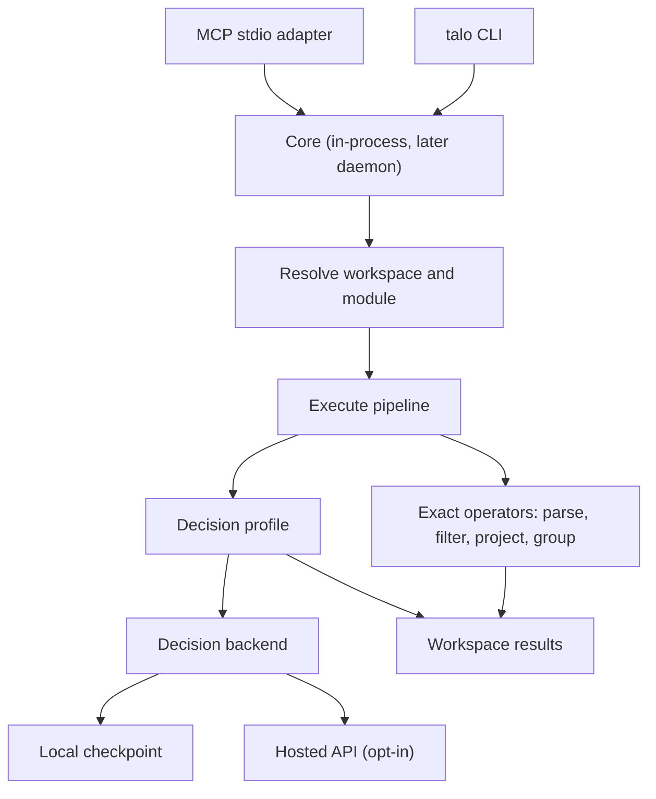

# Talo

Local decision and execution service for coding harnesses.

> **Status: skeleton.** This repository holds the V1 proposal and a project skeleton: the core contracts, CLI entry point and test fixtures exist, but modules and decision backends are not implemented yet. Commands below describe the planned interface unless noted under [Development](#development). See the [service design](docs/Talo_Service_Design.md) for the full proposal.

## Why Talo

Coding agents spend tokens reading long files, logs and test reports to find the few records that matter. Talo lets a harness pass a local file, a list or a previous result to a service on the same machine. The service parses and filters the data, applies a small local decision model where judgment is needed, and returns only the records the harness needs next.

Multiple harnesses can share the same modules and loaded model. The success measure is **fewer main-model tokens per correctly completed task**.

## Example: compare two test runs

An agent edits a file and reruns the tests. Instead of reading both reports, it passes a manifest that points to them:

```json
{
  "baseline": {"path": "fixtures/tests/before.json"},
  "current": {"path": "fixtures/tests/after.json"}
}
```

```bash
talo run tests.diff --input fixtures/tests/comparison.json
```

Talo matches tests by stable ID and reports each transition:

| Test ID | Before | After | Finding |
|---|---|---|---|
| `parse.empty_input` | Failed | Passed | Fixed |
| `parse.bad_header` | Failed | Failed | Still failing |
| `export.csv` | Passed | Failed | Regression |
| `export.unicode` | Failed | Skipped | Skipped; fix unverified |
| `export.roundtrip` | Failed | Absent | Missing from current report; fix unverified |

The agent then fetches the evidence for one failure rather than the whole report.

## Planned modules

| Module | Inputs | Returns |
|---|---|---|
| `tests.diff` | Baseline and current test reports | Outcome transitions by test ID, coverage gaps, references to assertions |
| `logs.trace` | Structured logs and a request ID | Matching events with timestamps, service names and source lines |
| `changes.map` | Changed paths and rules mapping path patterns to checks | Matching services and suggested checks, plus unmatched paths |
| `i18n.check` | Reference catalog, translated catalogs, placeholder syntax | Missing keys and placeholder mismatches, by locale and key |

Exact comparisons run through deterministic modules, which keep working when the model is unavailable. The local model handles bounded judgment through three decision profiles:

| Profile | Model input | Service policy |
|---|---|---|
| Route | Text and an allowed set of labeled destinations | Return one allowed ID or abstain |
| Triage | Text and explicit category or priority definitions | Validate each output against the declared values |
| Select many | A criterion and uniquely identified candidates | Evaluate each candidate independently, preserve IDs, allow zero matches |

## Architecture

The CLI and a thin MCP stdio adapter call one shared Python core with the same versioned requests. They call it in-process at first; a per-user daemon on a Unix socket arrives with the local model, which is what it exists to share.



- **Core and daemon:** the core owns the module registry, workspace access and results. The daemon adds model lifetime and a bounded inference queue.
- **Decision profiles and backends:** profiles define what is asked and how answers are validated; backends define which model answers. Backends are `fake` (deterministic tests), `api` (a hosted model, opt-in per workspace because data leaves the machine) and `local` (a pinned on-machine checkpoint, Laya first). Thresholds are calibrated per profile, backend and model revision.
- **Workspaces:** each client session is bound to a configured root. Input paths and result references resolve only within that workspace.
- **Storage:** SQLite for module versions and run metadata, per-workspace files for larger results. Results expire after a configurable retention period.

## Planned interface

CLI output is JSON on stdout, with diagnostics on stderr. The MCP tool list stays small, so installing more parsers does not grow the tools in every prompt.

| CLI | MCP tool | Purpose |
|---|---|---|
| `talo modules list`, `talo modules find <query>` | `talo_discover` | Find modules by purpose or input type |
| `talo modules describe <id>` | `talo_describe` | Fetch one module's schema, examples and limits |
| `talo run <id> --input <file>` | `talo_run` | Execute a registered module or pipeline |
| `talo decide --task <profile> --input <file>` | `talo_decide` | Run a bounded routing, triage or selection task |
| `talo inspect <ref> --id <id>` | `talo_inspect` | Fetch one evidence record or a page of results |

The daemon is managed with `talo serve` and `talo status`. Inputs accept exactly one of a workspace-relative path, a small inline value or a result reference.

Responses report counts and IDs, and keep outcome uncertainty, incomplete execution and display truncation separate:

```json
{
  "schema_version": 1,
  "status": "completed",
  "input_count": 2400,
  "candidate_count": 18,
  "selected_count": 2,
  "selected_ids": ["it-118", "it-205"],
  "uncertain_count": 1,
  "uncertain_ids": ["it-209"],
  "unprocessed_count": 0,
  "truncated": false,
  "result_ref": "result://r104"
}
```

## Extending Talo

A module package contains a manifest, input and output schemas, and example fixtures. Harnesses can add reusable modules through a scaffold, validate and register lifecycle:

```bash
talo modules scaffold tests.failed_integration --kind pipeline
# The harness edits the manifest, operator sequence and fixtures.
talo modules validate ./modules/tests.failed_integration
talo modules register ./modules/tests.failed_integration
```

V1 can register declarative pipelines over built-in operators automatically. Native parsers ship with Talo at first. Workspace-authored executable parsers stay disabled until an isolated runner enforces filesystem, time and memory limits.

## Roadmap

| Milestone | Demonstration that it works |
|---|---|
| 1. Exact processing | The same paired test reports give the same IDs and counts through CLI and MCP, and a different workspace cannot resolve the reference. `tests.diff` reads synthetic JSON and JUnit XML |
| 2a. Decision profiles | Route, triage and select-many run against the fake backend and an opt-in API backend, with labelled sets and tuned thresholds |
| 2b. Local decisions | The local backend and the daemon land together, with checkpoint, peak RAM, cold-start time and warm latency recorded |
| 3. Reuse across harnesses | One harness registers a declarative module and a second discovers and runs it |
| 4. End-to-end comparison | Held-out tasks replayed four ways: normal harness, exact modules, exact modules plus the local model, and exact modules plus the API model |

A decision profile is enabled by default only if it stays within an agreed quality tolerance and reduces total harness token use. Decision-backend tokens and cost are reported separately from main-model tokens.

The first implementation ticket is `tests.diff`, with two synthetic JSON reports, a comparison manifest and expected transitions, exposed through both clients.

## Development

Requires [uv](https://docs.astral.sh/uv/) and Python 3.12 or later (the repo pins 3.14).

```bash
uv sync
```

```bash
uv run pytest
```

```bash
uv run ruff check .
```

`uv run talo modules list` and `uv run talo models list` work today. Other commands return a typed `not_implemented` error.

Decision models are named entries in a models file. Copy [models.example.toml](models.example.toml) to `~/.config/talo/models.toml`, or point `TALO_MODELS_FILE` at it. Environment variables pick among the defined names:

```bash
TALO_DECISION_MODEL=small-llm TALO_DECISION_MODEL_SELECT_MANY=haiku uv run talo models list
```

`TALO_DECISION_MODEL` sets the default for every profile and `TALO_DECISION_MODEL_<PROFILE>` overrides one profile. A remote (`api`) model is still refused unless the workspace allows remote decisions. The `tests.diff` golden test is marked as an expected failure until the module is implemented.

Layout:

```
src/talo/
  core/          # envelope, typed errors, input references, workspace, result store, manifest
  operators/     # exact steps: parse, filter, project, group
  modules/       # built-in modules, e.g. tests_diff
  decisions/     # profiles, backends (fake, api, local), calibration
  runtime/       # daemon, arrives with the local backend
  cli.py
  mcp_server.py
fixtures/tests/  # synthetic reports, comparison manifest, expected transitions
tests/
```

## License

[MIT](LICENSE) © 2026 Ashot Gasparyan
