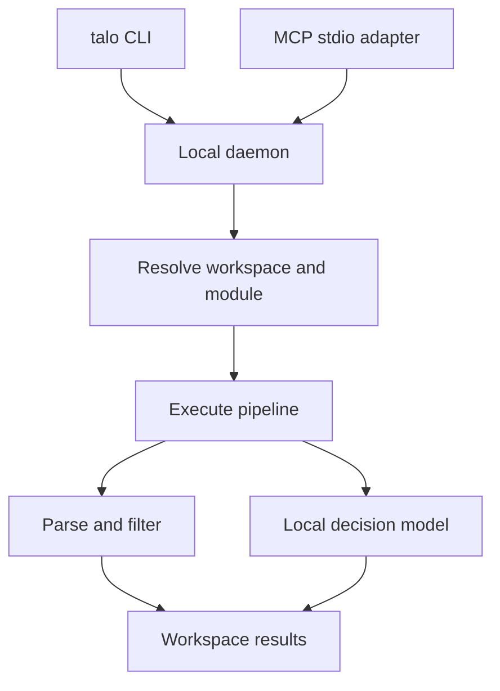

# Talo · Local decision and execution service

**V1 proposal · Command examples describe the planned interface.**

Talo lets a coding harness pass a local file, a list or a previous result to a service on the same machine. The service parses and filters data, applies a small decision model where judgment is needed, and returns the few records the harness needs next. Multiple harnesses can reuse the same modules and loaded model. The success measure is fewer main-model tokens per correctly completed task.

## 1. Everyday coding workflows

A coding agent edits a file and reruns the tests. Both runs produce hundreds of lines of output. The developer wants to know three things: which failure disappeared, which one persists, and what broke after the edit. Talo can answer from the two reports using stable test IDs and recorded outcomes. The agent then opens the assertion and stack trace for a specific failure.

| Proposed module | Inputs | What the caller receives |
|---|---|---|
| `tests.diff` | Baseline and current test reports | Outcome transitions by test ID, coverage gaps and references to assertions |
| `logs.trace` | Structured logs and a request ID | Matching events with timestamps, service names and source lines; missing timestamps stay explicit |
| `changes.map` | Changed paths and repository rules mapping path patterns to checks | Matching services and suggested checks, plus unmatched paths |
| `i18n.check` | A reference message catalog, translated catalogs and a placeholder syntax | Missing keys and placeholder mismatches, with the locale and key for each finding |

### First module: compare two test runs

Pass a small comparison manifest through the regular single-input interface. Paths in this manifest are relative to the bound workspace. Each test report in this first example is a JSON array of records with a unique `id` and an `outcome` of `passed`, `failed` or `skipped`.

```json
{
  "baseline": {"path": "fixtures/tests/before.json"},
  "current": {"path": "fixtures/tests/after.json"}
}
```

```bash
talo run tests.diff --input fixtures/tests/comparison.json
```

| Test ID in the synthetic fixture | Before | After | Finding |
|---|---|---|---|
| `parse.empty_input` | Failed | Passed | Fixed |
| `parse.bad_header` | Failed | Failed | Still failing |
| `export.csv` | Passed | Failed | Regression |
| `export.unicode` | Failed | Skipped | Skipped; fix unverified |
| `export.roundtrip` | Failed | Absent | Missing from current report; fix unverified |

Record both outcomes for each transition. A failure on a newly added test gets its own category because it has no passing baseline. Reject duplicate IDs as ambiguous in the first report format. For repeated runs, the same manifest can supply one workspace result reference per side in place of a path. Keep report contents local and provide paged findings with evidence references.

Run exact comparisons through deterministic modules. Use the local model for a follow-up such as “Which failures might share an authentication issue?” The parser supplies candidate IDs and assertion text, the model suggests related failures, and the coding agent inspects the evidence. To hand work to another agent in the same workspace, pass the result reference and the revision tested.

## 2. Runtime and boundaries

Start with one Python daemon per OS user on macOS. A shell command and a thin MCP stdio adapter send the same versioned requests to a user-only Unix socket. The daemon owns the registry, workspace access, model lifetime and results. A CLI-only project can use the full runtime. A client that runs remotely needs a bridge running on the machine that owns the files.



**Process lifetime.** Start with explicit `talo serve` and `talo status`. Load one configured checkpoint on the first semantic call and reuse it across clients. Deterministic operations work even when the model is unavailable. Bound the inference queue and return a retryable busy response when full. Pin a local checkpoint revision during setup so normal operation can run offline. Laya is the first adapter to evaluate. Its accuracy, memory use and latency on the reference machine are open measurements.

**Workspace and storage.** Bind each client session to a configured workspace root. Resolve input paths within that root, including symlinks. Keep module versions and run metadata in SQLite, and larger results in per-workspace files. Resolve result references against the session workspace. Publish completed results atomically and expire them after a configurable retention period. The registry stores module versions. Each run records the exact module versions, decision profile, checkpoint and policy that produced it.

## 3. Caller contract

Expose a small set of MCP tools so installing more parsers does not expand the tool list in every prompt. CLI output is JSON on stdout for machine callers, with diagnostics on stderr. All commands and fixture paths in this document illustrate the proposed interface.

| CLI | MCP tool | Purpose |
|---|---|---|
| `talo modules list`, `talo modules find <query>` | `talo_discover` | Find a short list of modules by purpose or input type |
| `talo modules describe <id>` | `talo_describe` | Fetch one module’s schema, examples and limits |
| `talo run <id> --input <file>` | `talo_run` | Execute a registered module or pipeline |
| `talo decide --task <profile> --input <file>` | `talo_decide` | Run a bounded routing, triage or selection task |
| `talo inspect <ref> --id <id>` | `talo_inspect` | Fetch a bounded evidence record or a page of results |

Inputs accept exactly one of a workspace-relative path, a small inline value, or a result reference. Streaming parsers should use stable source IDs or derive them from file identity and record position. Display limits apply after processing. If an execution budget prevents full coverage, mark the run partial and report the number left unprocessed.

**Example call**

```bash
talo run tests.auth_failures --input artifacts/integration.json --limit 5
```

**Example result** (illustrative counts)

```json
{
  "schema_version": 1,
  "status": "completed",
  "input_count": 2400,
  "candidate_count": 18,
  "selected_count": 2,
  "selected_ids": ["it-118", "it-205"],
  "uncertain_count": 1,
  "uncertain_ids": ["it-209"],
  "unprocessed_count": 0,
  "truncated": false,
  "result_ref": "result://r104"
}
```

All 18 candidates were evaluated. Two matched, one needs the harness’s judgment and 15 were excluded. The harness can run `talo inspect result://r104 --id it-209` to retrieve the source location and failure message. An empty list is a valid result after complete evaluation. A missing checkpoint, invalid input or expired reference returns a typed error. Each response distinguishes outcome uncertainty, incomplete execution and display truncation.

## 4. Modules and decision profiles

A module package contains a manifest, input and output schemas, and example fixtures. The manifest declares an ID, immutable version, kind, short discovery description, accepted inputs and resource limits. Start with exact operators for parse, filter, project and group. A pipeline composes versioned operators and profiles. Intermediate records stay inside Talo.

For the example above, the pipeline is `parse.json → rows.filter → decisions.select_many → result.store`. The exact filter checks `suite == integration` and `status == failed`. Only the test ID and relevant failure text reach the model. The full source stays available through the result reference.

| Profile | Model input and output | Service policy |
|---|---|---|
| Route | Text and an allowed set of labeled destinations | Return one allowed ID or abstain |
| Triage | Text and explicit category or priority definitions | Validate each output against the declared values |
| Select many | A criterion plus uniquely identified candidates | Evaluate each candidate independently, preserve IDs, allow zero matches |

Tune the acceptance and abstention thresholds on labeled examples for each profile. For multi-select, use independent relevance decisions so several items can qualify. Treat a cap on displayed items separately from a requirement to choose exactly K. When the input exceeds the model’s context, apply a profile-defined extraction rule or return an incomplete outcome. Silent clipping can remove the only useful evidence.

## 5. How harnesses learn and extend Talo

Ship two short instruction files with the service. Setup places a short pointer in each participating harness’s supported project instructions. Keep detailed module schemas and authoring guidance available on demand.

**Using Talo.** “When the source is a local file or long candidate list, pass its path or reference before reading it into context. Reuse a known module directly. Discover one if needed. Use exact predicates for exact conditions and decision profiles for judgments with defined outputs. Inspect uncertain records before making a downstream decision.”

**Adding a module.** “Use a simple shell command for a one-off lookup. When the same transformation recurs or a second harness needs it, search the registry and check whether existing operators can express it. If a reusable capability is missing, scaffold a workspace module, define its input and output, add a representative fixture and an edge case, validate it, then register the version. Use the registered module on subsequent calls.”

```bash
talo modules scaffold tests.failed_integration --kind pipeline
# The harness edits the manifest, operator sequence and fixtures.
talo modules validate ./modules/tests.failed_integration
talo modules register ./modules/tests.failed_integration
```

Authoring-enabled MCP sessions expose the same lifecycle through a single `talo_module_manage` tool with scaffold, validate and register operations. The harness edits the scaffold using its existing workspace editor. V1 can safely support automatic registration of declarative pipelines over built-in operators. A genuinely new parser, such as a proprietary test format, is a versioned code extension with a separate trust decision. Ship trusted native parsers with Talo initially. Enable workspace-authored executable parsers only once an isolated runner with enforced filesystem, time and memory limits is available. A successful fixture check establishes behavior on those examples, not permission to execute arbitrary code.

## 6. Build order and acceptance

| Milestone | Demonstration that it works |
|---|---|
| 1 · Exact processing | Run the same paired test reports through CLI and MCP. Both produce the same IDs and counts. Inspect an evidence record. A different workspace cannot resolve the reference. |
| 2 · Local decisions | Run routing and multi-select on the reference machine. Record checkpoint, peak RAM, cold-start time and warm p50/p95 latency. Exercise an ambiguous case and a missing checkpoint. |
| 3 · Reuse across harnesses | One harness scaffolds, validates and registers a declarative module. A second harness discovers and runs it. A failed registration leaves the previous version usable. |
| 4 · End-to-end comparison | Replay the same held-out tasks in three modes: normal harness, exact Talo modules, and exact modules plus the local model. Include empty results, poor candidates and ambiguous failures. |

For each mode, measure total main-model input and output tokens per completed task, including tool descriptions, retries, inspections and escalation. Report task success independently so failed runs cannot improve the savings figure. For selection, also report precision and recall against human-reviewed labels, especially missed relevant IDs. For routing, report incorrect accepted routes and coverage. Compare wall-clock time and memory at the same time.

**First release decision.** Agree on a quality tolerance per task before running the held-out comparison. Enable a profile by default only when it stays within that tolerance and reduces total harness token use. Keep a small opt-in set of reviewed corrections for later tuning, separated from the held-out evaluation set. The first benchmark should determine which tasks deserve a local model and which already get the full benefit from a parser and filter.

**First implementation ticket.** Ship `tests.diff` with the two synthetic JSON reports described in section 1, a comparison manifest and expected transitions. Expose the module through both clients and let callers inspect individual failures. Replay an edit-and-test session with this module, then add semantic failure grouping in a separate benchmark so each change has a measurable effect.
